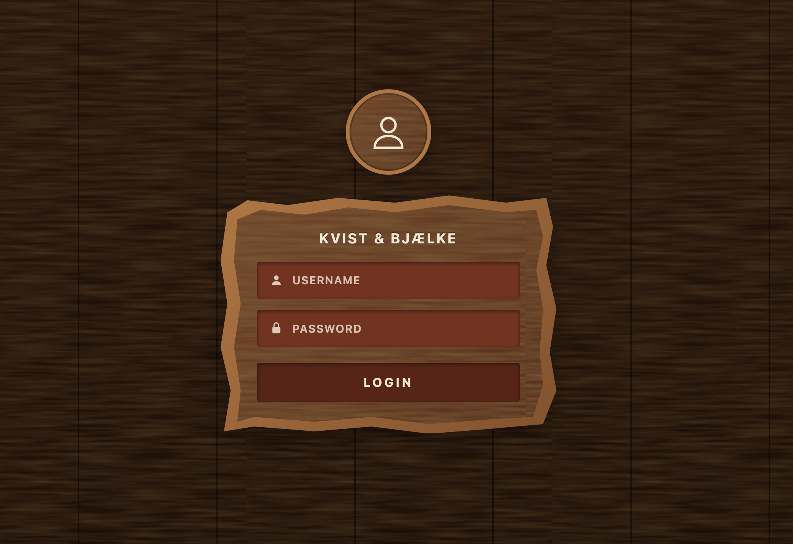

 <div align="center">


# Kvist & Bjælke ApS
### IT Infrastructure & Secure Authentication

Connor & Sally


</div>

---

# Table of Contents

- [About the Project](#about-the-project)
- [Tech Stack](#tech-stack)
- [Infrastructure](#infrastructure)
    - [IP Addressing Plan](#ip-addressing-plan)
    - [Subnetting](#subnetting)
    - [Frequently asked questions](#frequently-asked-questions-from-the-assignment)
    - [Client and Server Communication](#client-and-server-communication)
- [Authentication & Security](#authentication--security)
    - [Password Hashing](#password-hashing)
    - [Cookie Authentication](#cookie-authentication)
    - [Role-Based Access Control](#role-based-access-control)
    - [Extra Security Measures](#extra-security-measures)
- [Getting Started](#getting-started)
    - [Prerequisites](#prerequisites)
    - [Installation](#installation)
    - [Running with Docker Compose](#running-with-docker-compose)
    - [Running Components Individually](#running-components-individually)
- [Docker Deployment](#docker-deployment)
- [Screenshots](#screenshots)
- [Challenges & Solutions](#challenges--solutions)
- [Use of AI](#use-of-ai)
- [Reflections](#reflections)
- [References](#references)

---

## About the Project

Kvist & Bjælke ApS wants a secure login platform and a modernised network.

In this compulsory assignment, we have been assigned the task of developing the login platform
and designing and establishing the necessary infrastructure.

The project is divided into two main components:

**CDS.infrastructure:** Design and implementation of the company's network infrastructure.

**CDS.security:** Development of a secure login platform with user authentication and role-based access control.

The two courses are then connected as the login application from CDS.Security is deployed on the infrastructure from CDS.Infrastructure

The login platform is built as a web application with a React and TypeScript frontend and an ASP.NET Core Web API backend. 
The backend stores user information in SQLite. Docker Compose is used to run the frontend and API as separate containers.

The assignment's infrastructure design separates employee/client devices from servers using VLAN 570 and VLAN 571. 
The proposed company-wide design also includes separate networks for phones, printers, cameras, guests and network management.

## Tech Stack

<details>
  <summary>Backend & API</summary>

- <a href="https://dotnet.microsoft.com/en-us/apps/aspnet">ASP.NET Core Web API</a>
- <a href="https://learn.microsoft.com/en-us/dotnet/csharp/">C#</a>
- <a href="https://learn.microsoft.com/en-us/aspnet/core/security/authentication/cookie">ASP.NET Core Cookie Authentication</a>
- <a href="https://www.nuget.org/packages/Konscious.Security.Cryptography.Argon2">Argon2id Password Hashing</a>

</details>

<details>
<summary>Frontend</summary>

- <a href="https://react.dev/">React</a>
- <a href="https://www.typescriptlang.org/">TypeScript</a>
- <a href="https://bun.sh/">Bun</a>

</details>

<details>
<summary>Database & Data Access</summary>

- <a href="https://www.sqlite.org/">SQLite</a>
- <a href="https://www.linq2db.com/">linq2db</a>
- <a href="https://learn.microsoft.com/en-us/dotnet/standard/data/sqlite/">Microsoft.Data.Sqlite</a>

</details>

<details>
<summary>Infrastructure & DevOps</summary>

- <a href="https://ubuntu.com/server">Ubuntu Server</a>
- <a href="https://www.docker.com/">Docker</a>
- <a href="https://docs.docker.com/compose/">Docker Compose</a>
- <a href="https://git-scm.com/">Git</a>
- <a href="https://github.com/">GitHub</a>

</details>

<details>
<summary>Networking</summary>

- IPv4
- VLAN (570 & 571)
- Subnetting & CIDR
- TCP/IP
- Firewall Configuration
- Network Segmentation

</details>

<details>
<summary>Development & Testing</summary>

- <a href="https://learn.microsoft.com/en-us/dotnet/core/tools/">.NET CLI</a>
- <a href="https://bun.sh/docs">Bun CLI</a>
- Role-Based Access Control Testing
- Authentication & Authorization Testing

</details>

---

## Infrastructure

### Network Design

The network is designed using VLAN segmentation to separate clients and servers.

| VLAN | Network      | Purpose        |
|------|--------------|----------------|
| 570  | 10.5.70.0/24 | Client network |
| 571  | 10.5.71.0/24 | Server network |

For the company network we use the private range `10.5.0.0/16`. We were given VLAN 570 (clients, `10.5.70.0/24`) and VLAN 571 (servers, `10.5.71.0/24`),
so we continued the same pattern for the rest:
VLAN `57X` uses the network `10.5.7X.0`. This makes it easy to see which VLAN an IP address belongs to.

The default gateway in every network is the first usable address (`.1`). The gateway is on the firewall/router, which routes traffic between the VLANs.


### IP Addressing Plan

| VLAN | Name       | Network                | Subnet mask       | Default gateway | Usable hosts | Devices                                               |
|------|------------|------------------------|-------------------|-----------------|--------------|-------------------------------------------------------|
| 570  | Clients    | `10.5.70.0/24` (given) | `255.255.255.0`   | `10.5.70.1`     | 254          | 15 desktops, 10 laptops                               |
| 571  | Servers    | `10.5.71.0/24` (given) | `255.255.255.0`   | `10.5.71.1`     | 254          | 3 servers                                             |
| 572  | Phones     | `10.5.72.0/26`         | `255.255.255.192` | `10.5.72.1`     | 62           | 12 IP phones                                          |
| 573  | Printers   | `10.5.73.0/28`         | `255.255.255.240` | `10.5.73.1`     | 14           | 3 network printers                                    |
| 574  | Cameras    | `10.5.74.0/27`         | `255.255.255.224` | `10.5.74.1`     | 30           | 6 surveillance cameras                                |
| 575  | Guest      | `10.5.75.0/24`         | `255.255.255.0`   | `10.5.75.1`     | 254          | Visitors' phones and computers                        |
| 576  | Management | `10.5.76.0/27`         | `255.255.255.224` | `10.5.76.1`     | 30           | Switches, 4 access points, router/firewall management |

The 4 wireless access points send out two Wi-Fi networks: one for employees (VLAN 570) and one for guests (VLAN 575). The access points themselves are placed in the management VLAN 576.

#### Static IP addresses and DHCP

| VLAN           | Static or DHCP? | Address ranges                                           |
|----------------|-----------------|----------------------------------------------------------|
| 570 Clients    | DHCP            | `.1` gateway, `.2–.19` static, `.20–.250` DHCP           |
| 571 Servers    | Static          | `.1` gateway, `.10–.99` servers, rest reserved for later |
| 572 Phones     | DHCP            | `.1` gateway, `.10–.62` DHCP                             |
| 573 Printers   | Static          | `.1` gateway, `.2–.14` printers                          |
| 574 Cameras    | Static          | `.1` gateway, `.2–.30` cameras                           |
| 575 Guest      | DHCP            | `.1` gateway, `.10–.250` DHCP                            |
| 576 Management | Static          | `.1` gateway, `.2–.30` network equipment                 |

- **Static IPs for servers, printers, cameras and network equipment.** Other devices need to find these every time, so their address should not change.
They also keep working if the DHCP server goes down.
- **DHCP for clients, phones and guests.** These devices change often (new laptops, visitors), 
and DHCP saves us from configuring each device by hand and avoids two devices getting the same IP.

We could have put all devices on one network, but separating them is better for security and for keeping the network organized:

- **Servers (571) and clients (570):** The servers contain the company's systems and the login platform. When they are on a separate network, 
all traffic from the clients must go through the firewall, so we only allow what is needed (for example TCP ports 8000–8100). 
If a laptop gets infected, it can't just reach everything on the servers.
- **Guests (575):** Visitors' devices are not controlled by the company, so they only get Internet access and cannot reach the internal networks.
- **Phones (572):** Phones get their own network so they are not disturbed by all the traffic from the computers.
- **Cameras (574) and printers (573):** These devices are often not updated and can have security holes.
If they are on their own networks, a hacked camera or printer cannot easily be used to attack the rest of the company.
- **Management (576):** Only administrators should be able to log in to switches, access points and the firewall.
- **Smaller networks in general:** Each VLAN is its own broadcast domain, so there is less unnecessary traffic, and it is easier to find errors.

### Subnetting
|                       | VLAN 570 Clients | VLAN 572 Phones   | VLAN 573 Printers | VLAN 574 Cameras  |
|-----------------------|------------------|-------------------|-------------------|-------------------|
| **Network address**   | `10.5.70.0`      | `10.5.72.0`       | `10.5.73.0`       | `10.5.74.0`       |
| **CIDR**              | `/24`            | `/26`             | `/28`             | `/27`             |
| **Subnet mask**       | `255.255.255.0`  | `255.255.255.192` | `255.255.255.240` | `255.255.255.224` |
| **Host bits**         | 8                | 6                 | 4                 | 5                 |
| **Usable hosts**      | 254              | 62                | 14                | 30                |
| **Usable range**      | `.1 – .254`      | `.1 – .62`        | `.1 – .14`        | `.1 – .30`        |
| **Broadcast address** | `10.5.70.255`    | `10.5.72.63`      | `10.5.73.15`      | `10.5.74.31`      |
| **Devices today**     | 25               | 12                | 3                 | 6                 |

#### Why we chose these subnets
- **VLAN 570 (/24, 254 hosts):** This size was given. It is much bigger than the 25 devices we have today, so there is plenty of room for new employees.
- **VLAN 572 (/26, 62 hosts):** We have 12 phones. A smaller subnet would work today, but every new employee needs a phone,
so we chose 62 addresses to leave room for growth without wasting a whole /24.
- **VLAN 573 (/28, 14 hosts):** We only have 3 printers. A /29 would only give 6 hosts, which is a bit too tight, so /28 is a good fit.
- **VLAN 574 (/27, 30 hosts):** We have 6 cameras, but more are likely to be added, so 30 addresses give room for several more.

#### Room for 1 more?
All subnets have more addresses than we need today, so the company can add devices without changing anything.

> **Note:** We also gave each VLAN its own `10.5.7X.0` block in the plan. If a smaller subnet becomes full,
we can make it bigger (for example the cameras from `/27` to `/26`) without changing the IP addresses of the existing devices and without colliding with another VLAN.
> 
New VLANs can use the unused ranges from `10.5.77.0` and up.

---

### Frequently asked questions (from the assignment)
#### Why are VLAN 570 and VLAN 571 separate networks?

VLAN 570 is for the clients (`10.5.70.0/24`) and VLAN 571 is for the servers (`10.5.71.0/24`). They are separate because they have different jobs and need different security.

- A VLAN is a *virtual* network on the switch. Even if two devices are plugged into the same physical switch, 
- they cannot talk directly to each other if they are in different VLANs.
- The servers hold the company's systems and the login platform, so they are more important to protect than ordinary computers. 
If the servers were on the same network as the clients, any infected laptop could try to reach the servers directly.
- Each VLAN is its own broadcast domain, so broadcast traffic from the clients does not disturb the servers.
- It gives the company control: since all traffic between the two networks has to go through the firewall, the company decides what is allowed.

#### Why does communication between VLANs need routing?

The two VLANs are different IP networks. A computer can only talk directly to devices in its own network. 
To reach a device in another network, it must send the traffic to its default gateway, which is a router.

#### What is the role of the firewall?

The firewall sits between the networks and decides which traffic is allowed to pass. 
It checks each connection against a set of rules and then either allows or blocks it. 
Normally everything is blocked by default, and only the traffic that is really needed is allowed.

In our case, the rule says that clients in VLAN 570 may connect to servers in VLAN 571 on TCP ports 8000–8100. 
All other traffic between the VLANs is blocked. 
The firewall is also stateful, which means that when a client's connection is allowed, 
the server's answers to that connection are allowed back automatically.

So the router makes communication *possible* between the networks, and the firewall decides what is allowed.

#### Why should we only allow specific ports?

The fewer ports that are open, the fewer ways there are to attack the server.

- The clients only need to use the login platform, which runs on one port between 8000 and 8100. 
- There is no reason for them to reach other services on the server so we keep those blocked.
- If a client's computer gets infected, the attacker can only reach the login platform and not every service on the server. 
This limits the damage.
- It follows the principle of least privilege: only give access to what is needed and nothing more.
- It makes it easier to see problems, because traffic on ports that should be closed is blocked and stands out.


### Client and Server Communication
The client environment is connected to VLAN 570, while the server environment is connected to VLAN 571.

The client accesses the web application through the frontend on TCP port 8080.

The frontend communicates with the backend API through the configured `/api` proxy.

Firewall rules in the assignment environment are preconfigured to permit the required TCP port range of 8000–8100. 
These rules are part of the provided environment and are not configured as part of this project.

The network segmentation separates client devices from server infrastructure while allowing the required application traffic.

---

## Authentication & Security

### Password Hashing

Passwords are hashed using Argon2id through the Konscious.Security.Cryptography.Argon2 library.

Each password is hashed using a unique salt. The application stores the resulting password hash rather than the original password.

### Cookie Authentication

The application uses cookie-based authentication.

Authentication cookies are configured with:
- HttpOnly
- SameSite=Strict
- A 30-minute expiration
- Sliding expiration

The Secure cookie setting is configurable. In the current Docker Compose development configuration, Secure cookies are disabled.
Production deployment should of course use HTTPS and Secure cookies

### Role-Based Access Control

The application has three roles:

| Role      | Description                                                 |
|-----------|-------------------------------------------------------------|
| User      | Can view standard user accounts                             |
| SuperUser | Can create, view, update, and delete standard User accounts |
| Admin     | Has management permissions across all user roles            |


Authorization is enforced by the backend service layer.

Users cannot change their own role or delete their own account through the user management functionality.

### Extra Security Measures

Other security measures include:

- Login rate limiting to limit repeated login attempts.
- Generic login failure messages to avoid revealing whether a username exists.
- Dummy password verification when a username does not exist, helping
  reduce timing differences between failed login attempts.
- Input validation.
- Password hashes are never included in API responses.
- Session validation against the database.
- Security-related HTTP response headers.
- Backend authorization checks to prevent unauthorized access to protected operations.

---

## Getting Started

### Prerequisites

The following software is required to run the application:

- [Git](https://git-scm.com/) – to clone the repository.
- [Docker](https://www.docker.com/) – to build and run the application containers.
- [Docker Compose](https://docs.docker.com/compose/) – to manage the frontend and backend services.
- [.NET 10 SDK](https://dotnet.microsoft.com/download/dotnet/10.0) – required if you want to build or run the backend outside Docker.
- [Bun](https://bun.sh/) – required if you want to install frontend dependencies or run the frontend outside Docker.

SQLite is used as the application database. It is handled by the backend through `Microsoft.Data.Sqlite` and `linq2db`,
so a separate SQLite server installation is not required.

### Installation

Clone the repository:

```bash
git clone https://github.com/ConMcg2025/very-secure-login.git
```

Navigate to the project directory

### Running with Docker Compose

The recommended way to run the application is through Docker Compose. This builds and starts the frontend and backend containers together.

Build and start the application:

```bash
docker compose up --build -d
```

Check that the containers are running:

```bash
docker compose ps
```

View application logs:

```bash
docker compose logs
```

Open the frontend in your browser:

```text
http://localhost:8080
```

The frontend communicates with the backend through the configured `/api` proxy.

To stop the application:

```bash
docker compose down
```

The SQLite database is stored in the named Docker volume `server-data`, 
allowing database data to persist when containers are stopped or recreated. 

### Running Components Individually
**Backend**

Open the `server` directory in your terminal and run:

```bash
dotnet restore API/API.csproj
dotnet build API/API.csproj
dotnet run --project API/API.csproj
```

The API will listen on the address and port shown in the application startup output.

**Frontend**

Open the client directory in a separate terminal and run:

```bash
bun install
bun run dev
```

The development server address will be shown in the terminal.

---

## Docker Deployment

The application is deployed using Docker Compose on an Ubuntu Server environment.

The deployment consists of:

- **Frontend:** React application running in a Docker container.
- **Backend:** ASP.NET Core Web API running in a separate Docker container.
- **Database:** SQLite database stored in a persistent Docker volume.

### Deploying on Ubuntu Server

Clone the repository on the Ubuntu Server:

```bash
git clone https://github.com/ConMcg2025/very-secure-login.git
cd very-secure-login
```

Build and start the containers:

```bash
docker compose up --build -d
```

Verify the deployment:

```bash
docker compose ps
```

Check the logs if needed:

```bash
docker compose logs
```

### Managing the Deployment

To restart the application:

```bash
docker compose restart
```

To rebuild and restart after making changes:

```bash
docker compose up --build -d
```

To stop the containers:

```bash
docker compose down
```

The named `server-data` volume preserves the SQLite database when the containers are stopped or recreated.

---

## Screenshots
See "screenshots" for more goodies

**Login page**



---

## Challenges & Solutions


| Challenge                                                                    | Solution                                                          |
|------------------------------------------------------------------------------|-------------------------------------------------------------------|
| Working with proxmox and ubuntu                                              | Unsolved at this point - hopefully it'll be easier in the future? |
| 99% unexpected feedback when trying to do anything in the ubunto vm terminal | We'd like to know the solution too                                |
| Server not working                                                           | ^                                                                 |

---

## Use of AI

During this project, Claude and ChatGPT were used as support tools throughout the development process. 
The tools were used as a way to help us understand concepts, give us guidance on best practices, 
and planning the project structure. 
They were especially helpful during the initial stages of the project, 
where we used them to break down the requirements of the project and 
create a plan for how to approach the implementation. 
This proved to be very valuable to us as it helped us ensure 
that we were on the right track and that we were not missing any important details.
During the implementation phase, we used the tools to help us if we got stuck and to provide feedback on our code or ideas.

When working with the client VM, AI was used to aid in connectivity issues, but the AI ultimately determined it to be a physical issue.
We had no way to verify this and were sadly unable to connect.


---
## Reflections

Most of our time was spent wrestling with Ubuntu as we sadly aren't very familiar with it and didn't get to work with it 
much during the course. Last time we were supposed to work with it during class, it wasn't working for anybody and there were problems
with the servers. It's a shame as we feel that we would have been able to do a lot more if we had been able to get it working quickly. 
We also both agree that it might've been better if we'd contacted the teacher and asked for help.
We were able to host the server on VLAN 571, but unable to connect from the client VM even though from what we could tell, and with ai checking our work, that it should be working


Making a README took longer than expected which is something we will remember for next time for better time management.
We did enjoy trying to find different ways to "showcase" the text or make tables in here. 

Had we been working with a real company, we (hopefully) would've had a bit more hands-on experience and maybe colleagues to ask for 
assistance if needed. We probably also would've made the wooden theme a bit prettier but at least this current theme is.. unique. (right?)

---

## References
### Backend and Authentication
- [ASP.NET Core](https://learn.microsoft.com/en-us/aspnet/core/)
- [C# Documentation](https://learn.microsoft.com/en-us/dotnet/csharp/)
- [Cookie Authentication](https://learn.microsoft.com/en-us/aspnet/core/security/authentication/cookie)
- [Argon2 Library](https://www.nuget.org/packages/Konscious.Security.Cryptography.Argon2)

### Frontend
- [React](https://react.dev/)
- [TypeScript](https://www.typescriptlang.org/)
- [Bun](https://bun.sh/)

### Database
- [SQLite](https://www.sqlite.org/)
- [linq2db](https://www.linq2db.com/)
- [Microsoft.Data.Sqlite](https://learn.microsoft.com/en-us/dotnet/standard/data/sqlite/)

### Infrastructure
- [Ubuntu Server](https://ubuntu.com/server)
- [Docker](https://www.docker.com/)
- [Docker Compose](https://docs.docker.com/compose/)
- [Git](https://git-scm.com/)
- [GitHub](https://github.com/)

### Development Tools
- [.NET CLI](https://learn.microsoft.com/en-us/dotnet/core/tools/)
- [Bun Documentation](https://bun.sh/docs)
---

<div align="center">

**Kvist & Bjælke ApS**

*Compulsory Assignment – IT Infrastructure & Security*

</div>